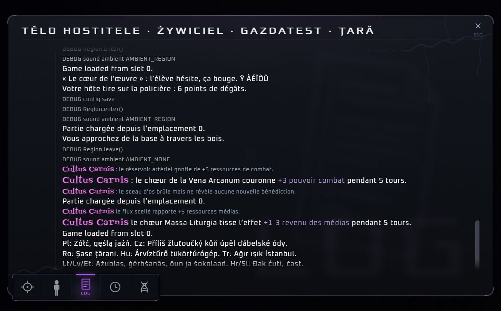
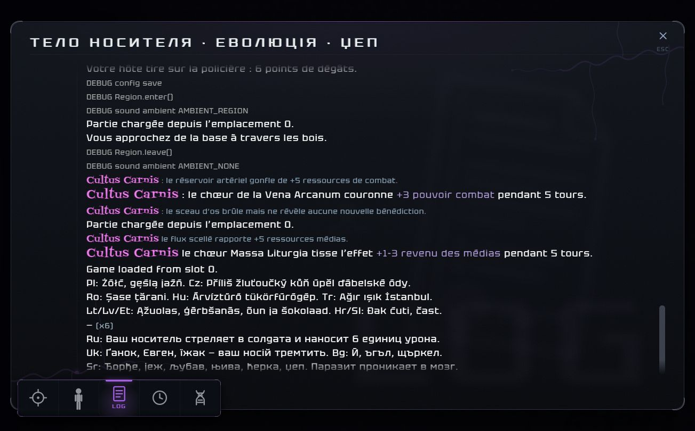
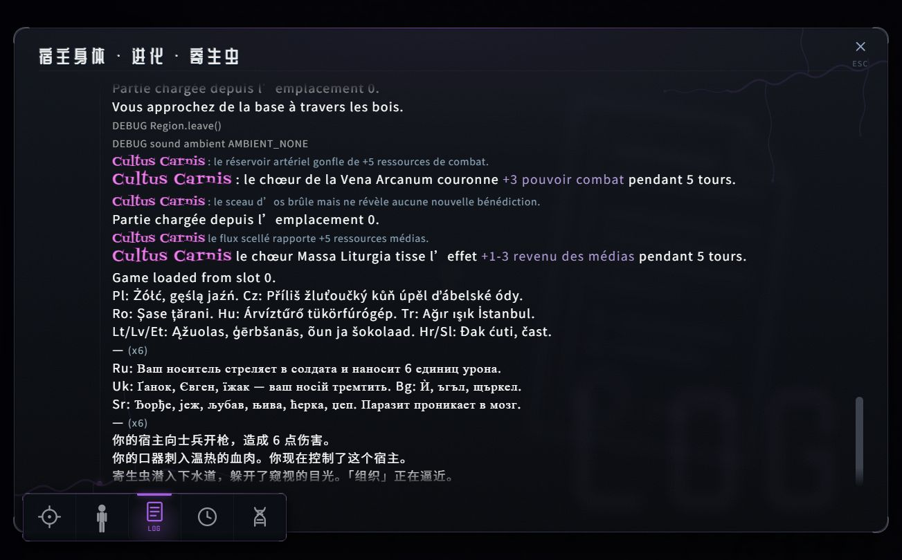
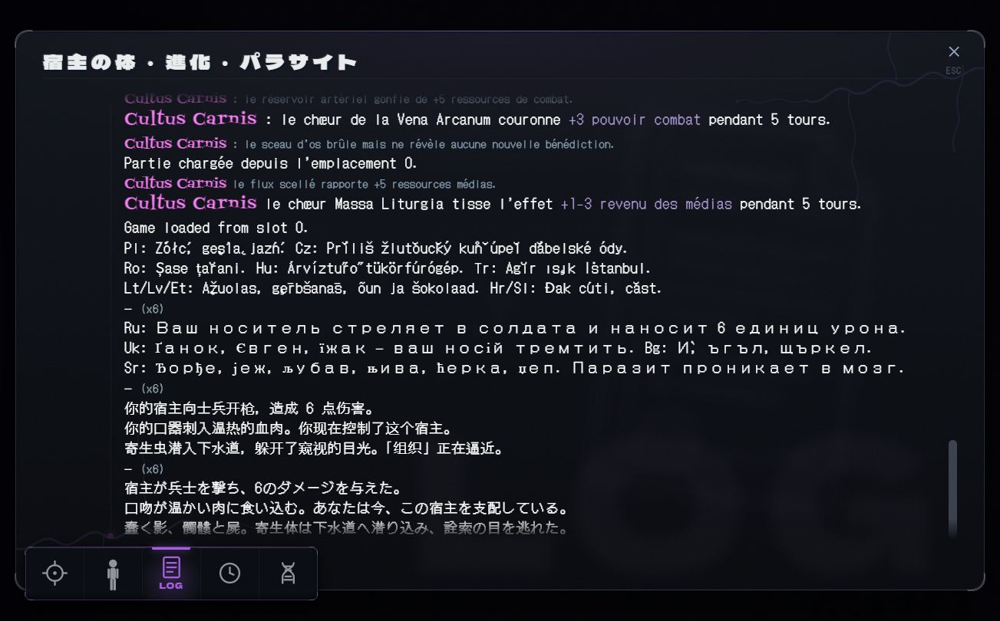
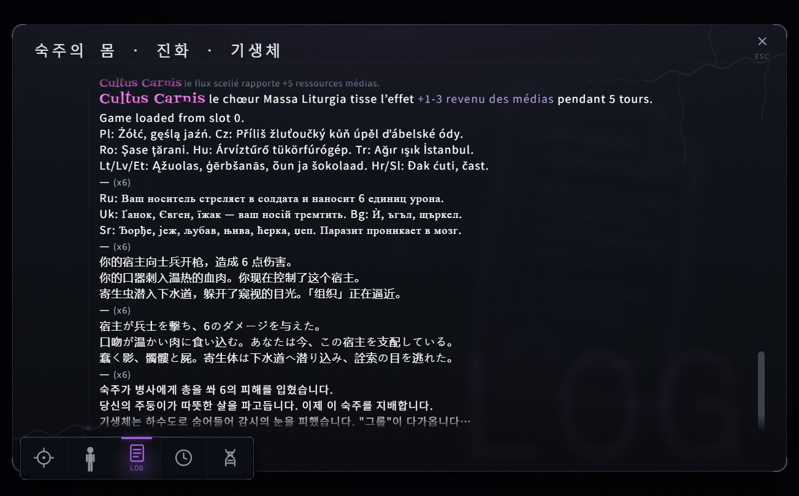

# Fonts for the next languages: Eastern European Latin, Cyrillic, CJK (draft)

Research only, no game code changed. Every coverage number comes from `fc-query --format=%{charset}` on the
actual file, which is how `tools/loc/fonts.py` reads it. Sizes come from the files themselves (KB = 1000 bytes).
Subsets were made with fontTools `pyftsubset` (fontTools 4.x, default layout features). Variable fonts were
pinned to a static Regular (wght 400, wdth 100) with `fonttools varLib.instancer`, since a static Regular is
what the game would ship.

## Recommendations

| script | TEXT | TITLE | new files | notes |
|---|---|---|---|---|
| Eastern European Latin (pl cs sk hu ro hr sl lt lv et tr) | **Oxanium** (new, 29 KB). Zero-cost option: **Orkney-Regular** (already shipped) | **Xolonium** (already shipped) | 0–1 | every shipped default fails these languages; see § 1 |
| Cyrillic (ru uk bg sr) | **Tektur** (new, 76 KB, has Bulgarian/Serbian `locl`). Safe option: **Exo 2** (151 KB) | **Xolonium** (already shipped) | 1 | the appended CSS fallback (Orkney) has no Cyrillic |
| Simplified Chinese | **Noto Sans SC**, subset (≈ 570 KB woff2) | **Noto Sans SC** (the text font; ZCOOL QingKe HuangYou dropped at the pick) | 1 | |
| Japanese | **DotGothic16**, subset (≈ 190–380 KB woff2). Fallback choice: **Noto Sans JP** | **DotGothic16** (the text font; Dela Gothic One dropped at the pick) | 1 | |
| Korean | **Noto Sans KR**, subset (166 KB woff2 for KS X 1001) | **Orbit** (175 KB woff2) | 2 | |
| Traditional Chinese (noted only) | Noto Sans TC, subset to Big5 level 1 (864 KB woff2) | n/a | 1 | |
| Pixel option, all of CJK | **Fusion Pixel 12px**: one design for SC/TC/JP/KR, 37–185 KB woff2 | same | 1 per region | sharp only at 12/24/36 px; game text is 16 px |

Picked by the developer (2026-11-02, from the side-by-side preview): Oxanium, Tektur, Exo 2, Noto Sans SC,
DotGothic16, Noto Sans JP, Noto Sans KR, Orbit. ZCOOL QingKe HuangYou and Dela Gothic One are out, so Chinese and
Japanese titles use their text font. The bitmap fonts (Fusion Pixel, the Oldschool PC Font Pack) were dropped from
the preview at the developer's request.

Surprises:
- **Tektur's acute accent is almost flat.** á/ā and é/ē are hard to tell apart even at 36 px
  (preview: `/tmp/claude-1000/-home-infidel-parasite/c8dd513a-ad04-4086-9537-e08ff81839c9/scratchpad/work/png/accents.png`). That is fine for Cyrillic, but bad wherever Czech/Slovak/Hungarian acutes meet Latvian
  macrons, so it is not recommended for Latin.
- **Virtucorp lacks even Š/Ž**, which are in Windows-1252, so it fails Estonian as well. The four "Western + Polish" fonts
  (Brainstorm, Montalban, Probert, Schnaubelt) are exactly that: Polish only.
- **The 3500 常用字 list is not inside GB2312 level 1.** 119 of the 3500 are outside level 1 (2 are outside GB2312
  altogether: 啰 瞭). Subset to the union of the two lists (3874).
- **Jōyō alone is too small for a horror game.** 蠢 贄 髑髏 蛆 (JIS level 2) and 喰 屍 (JIS level 1) are all outside Jōyō.
- **The Korean display fonts lack basic punctuation.** Do Hyeon and Black Han Sans have no — – … ·, and Gugi has not even
  curly quotes. Those characters fall back one glyph at a time.
- **M PLUS 1 Code lacks the fullwidth ！？：；，**, so it is unusable for Japanese prose. The tofu shows in `/tmp/claude-1000/-home-infidel-parasite/c8dd513a-ad04-4086-9537-e08ff81839c9/scratchpad/work/png/jp.png`.
- **SteamOS ships `noto-fonts-cjk` in every image checked**, from the 2022 launch image to 3.10.0. See § 4.
- **woff2 of a TrueType-outline subset is ~30 % smaller than the same subset from the CFF OTF.** Noto Sans SC, GB L1:
  550 KB vs 755 KB. Prefer the Google Fonts TTF (instanced) when shipping woff2.

## Character sets used

| set | size | source |
|---|---|---|
| EE letters | 110 | non-ASCII letters of the pl cs sk hu ro hr sl lt lv et tr alphabets, lower + upper (ro: comma-below ș ț; tr: ğ ı İ ş + â î û): `ÁÂÄÇÉÍÎÓÔÕÖÚÛÜÝ áâäçéíîóôõöúûüý ĀāĂ㥹ĆćČčĎďĐđĒēĖėĘęĚěĞğĢģĪīĮįİıĶķĹĺĻļĽľŁłŃńŅņŇňŐőŔŕŘřŚśŞşŠšŤťŪūŮůŰűŲųŹźŻżŽžȘșȚț` |
| EE punctuation | 13 | `„“”‚‘’«»‹›–—…` |
| Cyrillic letters | 88 | Russian 66 + Ukrainian Єє Іі Її Ґґ + Bulgarian Ѝѝ + Serbian Ђђ Јј Љљ Њњ Ћћ Џџ |
| Cyrillic punctuation | 11 | `«»„“”‘’–—…№` |
| GB2312 level 1 | 3755 | Python `gb2312` codec, rows 16–55 |
| GB2312 level 2 | 3008 | same, rows 56–87 |
| 通用规范汉字表 level 1 (3500 常用字) | 3500 | Unicode Unihan 18.0 (2026-07-31), `kTGH` index ≤ 3500 |
| Kana | 184 | U+3041–3096, 309B–309E, 30A1–30FE |
| Jōyō kanji (2010) | 2136 | Unihan 18.0 `kJoyoKanji = 2010` (official forms, incl. 𠮟 剝 塡 頰). The 4 accepted popular forms 剥 叱 填 頬 are checked separately |
| JIS X 0208 level 1 / level 2 | 2965 / 3390 | Python `euc_jp` codec, rows 16–47 / 48–84 |
| KS X 1001 hangul | 2350 | Python `euc_kr` codec, rows 16–40 |
| All modern hangul | 11172 | U+AC00–D7A3 |
| Big5 level 1 (TC) | 5401 | Python `big5` codec, A440–C67E |
| CJK punctuation | 29 | `—–“”‘’…·、。「」『』《》【】（）！？：；，〜・ー～` (KR uses the Western 8: `—–“”‘’…·`) |
| subset base (added to every CJK subset) | 395 | ASCII, Latin-1, U+2010–203B, CJK symbols U+3000–303F, fullwidth U+FF01–FF5E, № ™ (+ hangul compatibility jamo for KR) |

## 1. Eastern European Latin

### The game's own fonts, re-measured

| font(s) | EE letters | languages fully covered | what is missing |
|---|---|---|---|
| Xolonium | 110/110 | all 11 (+ ru uk bg sr) | none |
| Orkney-Regular | 110/110 | all 11 | none (punctuation 13/13) |
| Brainstorm, Montalban, Probert, Schnaubelt | 47/110 | pl | Č Ď Ě Ň Ř Š Ť Ů Ž, Ő Ű, Ă Ș Ț, Đ, Ė Į Ų Ū, Ğ İ Ş, … |
| Virtucorp, Cruiser2015, Alternity, Eurocorp, Horizon, Rapier-Zero, Rebellion, Sigma-Five-Sans, Sternbach, Twobit, Xball, Zebulon | 31/110 | none | everything outside Latin-1, even Š Ž (so et fails too) |
| FontdinerSwanky (not offered), OrbitronMedium (not offered) | 37, 35 | et | as above, minus Š Ž |
| Dusty, DemunLotion, FlipsideBrk | 0/110 | none | no accented letters at all |

Today Config appends Orkney as the glyph fallback, so a Polish log line in Virtucorp draws ż, ł and ę in Orkney inside a
Virtucorp word. A default with full coverage removes that mix.

### Candidates (all from google/fonts `ofl/`; RFN = Reserved Font Name)

| font | license | EE letters | punct. | size VF / static | verdict |
|---|---|---|---|---|---|
| **Oxanium** | OFL, no RFN | 110/110 | 13/13 | 43.5 / **29.0 KB** | squared techno, closest to Virtucorp; accents clear. No Cyrillic |
| Chakra Petch | OFL, no RFN | 110/110 | 13/13 | — / 78.5 KB | squared, angled cuts; techno; accents clear. No Cyrillic |
| Exo 2 | OFL, no RFN | 110/110 | 13/13 | 304 / 151 KB | the classic sci-fi UI sans, neutral; also covers all Cyrillic |
| Saira | OFL, no RFN | 110/110 | 13/13 | 484 / 83.2 KB | techno-ish; width axis 50–125 (a condensed cut is possible). No Cyrillic |
| Tektur | OFL, no RFN | 110/110 | 13/13 | 163 / 75.8 KB | techno, but **á≈ā, é≈ē**; not for Latin |
| Michroma | OFL, no RFN | 110/110 | 13/13 | — / 64.3 KB | very wide display, Cruiser2015-like; titles only |
| Jura | OFL, no RFN | 110/110 | 13/13 | 258 / 155 KB | thin techno; weak at 16 px |
| Play | OFL, RFN 'Play' | 110/110 | 13/13 | — / 199 KB | neutral, legible |
| Unbounded | OFL, no RFN | 110/110 | 13/13 | 778 / 417 KB | wide heavy display; big |
| Rubik / Comfortaa | OFL (Comfortaa RFN) | 110/110 | 13/13 | 360 / 212 KB, 202 / 111 KB | rounded, off-style |
| Rajdhani | OFL, no RFN | 108/110 | 13/13 | — / 378 KB | condensed techno; **ro: no Ț ț** (has cedilla Ţ ţ) |
| Russo One | OFL, RFN 'Russo' | 108/110 | 13/13 | — / 39.1 KB | heavy techno display; **ro: no Ț ț** |
| Audiowide | OFL, RFN | 106/110 | 13/13 | — / 69.9 KB | techno display; **ro: no Ș ș Ț ț** |
| Days One | OFL, RFN | 60/110 | 13/13 | — / 65.6 KB | fails pl hu ro hr lt lv tr |
| Aldrich, Quantico | OFL, RFN | 43/110 | 13/13 | 56.5, 20.9 KB | fail every language but et |
| Share Tech | OFL, RFN 'Share' | 37/110 | 13/13 | 53.1 KB | fails all but et |
| Orbitron | OFL, no RFN | 35/110 | 7/13 | 38.6 / 24.6 KB | fails all but et; no „ « » |
| Electrolize | OFL, RFN | 31/110 | 12/13 | 55.7 KB | Latin-1 only |

### Is Orkney as the default the better call?

Orkney is the correct zero-cost answer. It covers all 11 languages and their punctuation, is 61 KB, is already shipped, and is
already the fallback. Its weakness is the look: a clean geometric sans, not techno. Oxanium (29 KB) is the one addition
worth an in-game comparison against it. If one font should serve both EE and Cyrillic, Exo 2 does that at 151 KB.

**Recommended: text Oxanium (or Orkney), title Xolonium.**

## 2. Cyrillic

| font | license | Cyrillic (88) | punct. (11) | bg/sr `locl` | size VF / static | verdict |
|---|---|---|---|---|---|---|
| Xolonium (shipped) | (shipped) | 88/88 | 11/11 | no | 216 KB | techno display; the only shipped Cyrillic font |
| **Tektur** | OFL, no RFN | 88/88 | 11/11 | **BGR + SRB** | 163 / **75.8 KB** | squared techno, sits well with Xolonium; Cyrillic accents fine |
| **Exo 2** | OFL, no RFN | 88/88 | 11/11 | no (BSH only) | 304 / 151 KB | neutral sci-fi; most legible at 16 px |
| Play | OFL, RFN 'Play' | 88/88 | 11/11 | no | 199 KB | neutral, legible |
| Unbounded | OFL, no RFN | 88/88 | 11/11 | BGR + SRB | 778 / 417 KB | wide heavy display; titles only, big |
| Rubik | OFL, no RFN | 88/88 | 11/11 | no | 360 / 212 KB | rounded, off-style |
| Comfortaa | OFL, RFN | 88/88 | 11/11 | no | 202 / 111 KB | rounded; т drawn as m; off-style |
| Russo One | OFL, RFN 'Russo' | 86/88 | 11/11 | no | 39.1 KB | the classic Russian techno display; **no Ѝ ѝ** (bg) |
| Jura | OFL, no RFN | 86/88 | 11/11 | no | 258 / 155 KB | thin techno; **no Ѝ ѝ** |
| Days One | OFL, RFN | 86/88 | 11/11 | no | 65.6 KB | heavy; **no Ѝ ѝ**; also fails EE |
| Smiley Sans (CJK font) | OFL, RFN | 76/88 | 11/11 | no | 2.63 MB | no Serbian letters |
| Oxanium, Chakra Petch, Saira, Michroma, Rajdhani, Orbitron, Audiowide, Aldrich, Quantico, Share Tech, Electrolize | | 0/88 | | | | no Cyrillic |

- With Chromium, `locl` only applies when the document language is set, and `Loc.hx` already sets
  `documentElement.lang`. So Tektur draws Bulgarian- and Serbian-style letterforms by itself.
- ѝ appears only in Bulgarian. The fonts that have combining U+0300 (Exo 2, Tektur, Jura, Play, …) could draw a decomposed
  и + ◌̀. That is untested.
- Orkney, the fallback Config appends, has no Cyrillic. For ru/uk/bg/sr the fallback should be a Cyrillic font such as
  Xolonium, or a missing glyph drops to a system font.

**Recommended: text Tektur (or Exo 2), title Xolonium.**

## 3. CJK

All candidates are OFL. "subset" = the standard list + the subset base, given as raw / woff2.

### Simplified Chinese

| font | license | GB L1 3755 | 3500 list | GB L2 3008 | punct. 29 | full size | subset GB L1 | subset GB L1 ∪ 3500 | verdict |
|---|---|---|---|---|---|---|---|---|---|
| Noto Sans SC, OTF (noto-cjk SubsetOTF) | OFL, RFN 'Source' (not in its name) | 3755 | 3500 | 3008 | 29 | 8.33 MB | 988 KB / 755 KB | 1.02 MB / 779 KB | coverage layer |
| **Noto Sans SC**, TTF (Google Fonts) | same | 3755 | 3500 | 3008 | 29 | VF 17.8 MB, static 10.6 MB | 1.17 MB / **550 KB** | 1.21 MB / **568 KB** | same design, smaller woff2: **text** |
| **ZCOOL QingKe HuangYou** | OFL, no RFN | 3755 | 3500 | 3008 | 25 (no · 〜 ・ ー) | 8.33 MB | 2.84 MB / 919 KB | 2.94 MB / 952 KB | condensed square display, the techno one: **title** |
| Smiley Sans 得意黑 v2.0.1 | OFL, **RFN 'Smiley', '得意黑'** (rename when subsetting) | 3755 | 3500 | 3008 | 27 | 2.63 MB ttf / 2.00 MB otf | 1.02 MB / 505 KB | — | oblique only; sporty italic display |
| Fusion Pixel 12px zh_hans | OFL, no RFN | 3755 | 3500 | 2892 | 29 | 5.13 MB | 561 KB / 107 KB | 579 KB / 110 KB | pixel, 12 px grid |

Full GB2312 (6763) for reference: Noto SC TTF 2.19 MB / 983 KB woff2; ZCOOL 5.52 MB / 1.71 MB.

### Japanese

| font | kana 184 | Jōyō 2136 | JIS L1 2965 | JIS L2 3390 | punct. 29 | full size | subset kana + Jōyō | verdict |
|---|---|---|---|---|---|---|---|---|
| Noto Sans JP, OTF | 184 | 2136 | 2965 | 3390 | 29 | 4.53 MB | 666 KB / 503 KB | coverage layer |
| Noto Sans JP, TTF | 184 | 2136 | 2965 | 3390 | 29 | VF 9.59 MB, static 5.77 MB | 793 KB / 363 KB | fallback choice for text |
| **DotGothic16** | 184 | 2135 (no 𠮟; 叱 present) | 2965 | 3390 | 29 | 2.07 MB | 538 KB / **145 KB** | dot-matrix terminal look, drawn for 16 dots (= game's 16 px text). The dots are outline shapes, not a pixel grid, so it scales freely: **text** |
| **Dela Gothic One** | 180 (no ゕゖ゛゜) | 2136 | 2965 | 3390 | 29 | 2.51 MB | 624 KB / 328 KB | heavy black display; also has full EE + Cyrillic: **title** |
| Stick | 184 | 2135 (no 𠮟) | 2965 | 3390 | 29 | 2.22 MB | 563 KB / 287 KB | thin angular construction; alternative title |
| M PLUS 1 | 179 (no ゕゖ゛゜ヾ) | 2136 | 2965 | 2266 | 29 | VF 4.20 MB, static 1.84 MB | 645 KB / 284 KB | clean, neutral |
| M PLUS 1 Code | 179 | 2136 | 2965 | 2266 | **18** (no ！？：；，《》【】〜～) | VF 3.93 MB | 605 KB / 273 KB | not for prose |
| M PLUS Rounded 1c | 184 | 2136 | 2965 | 1943 | 29 | 3.39 MB | 1.18 MB / 414 KB | rounded, off-style |
| Fusion Pixel 12px ja | 184 | 2135 (no 𠮟) | 2965 | 3390 | 29 | 5.13 MB | 357 KB / 74 KB | pixel, 12 px grid |

A bigger list is safer for horror vocabulary: kana + Jōyō + JIS L1 (3578 chars incl. the base) gives Noto JP TTF
1.08 MB / 488 KB, DotGothic16 733 KB / 193 KB, Dela Gothic One 869 KB / 453 KB. Kana + Jōyō + JIS L1 + L2 gives
Noto JP TTF 2.30 MB / 992 KB, DotGothic16 1.54 MB / 376 KB, Dela Gothic One 1.90 MB / 947 KB.

### Korean

| font | KS X 1001 2350 | all 11172 | punct. (Western 8) | full size | subset KS X 1001 | verdict |
|---|---|---|---|---|---|---|
| Noto Sans KR, OTF | 2350 | 11172 | 8/8 | 4.64 MB | 396 KB / 249 KB | coverage layer |
| **Noto Sans KR**, TTF | 2350 | 11172 | 8/8 | VF 10.4 MB, static 6.22 MB | 490 KB / **166 KB** (all 11172: 2.47 MB / 549 KB) | **text** |
| **Orbit** | 2350 | 2780 | 8/8 | 784 KB | 607 KB / **175 KB** | geometric sci-fi display; also full EE Latin except Ț ț: **title** |
| Do Hyeon | 2350 | 2437 | 4/8 (no — – … ·) | 880 KB | 699 KB / 166 KB | bold condensed signage |
| Black Han Sans | 2350 | 2581 | 4/8 (no — – … ·) | 998 KB | 863 KB / 169 KB | heavy black |
| Gugi | 2350 | 2350 | 0/8 | 991 KB | 965 KB / 176 KB | quirky display; no punctuation at all |
| Fusion Pixel 12px ko | 2350 | 11172 | 8/8 | 5.12 MB | 284 KB / 37 KB | pixel, 12 px grid |

Display Korean fonts cover KS X 1001 plus a few hundred more. Any syllable outside that falls back one glyph at a time,
so the text font should be Noto, and only the title font a display font.

### Traditional Chinese (noted only)

Noto Sans TC covers Big5 level 1 5401/5401. Full size: OTF 5.68 MB, TTF VF 11.9 MB / static 7.15 MB. The Big5 L1 subset
is OTF 1.61 MB / 1.23 MB, TTF 1.91 MB / **864 KB** woff2. Fusion Pixel also covers Big5 L1 fully (its zh_hant variant was
not downloaded).

### CJK notes

- **Han unification.** Noto JP/KR/TC "cover" most GB2312 hanzi (JP 2725/3755, KR 2440/3755), but with their own regional
  glyph forms. Each language needs its own region's font. Chromium picks regional glyphs in system fallback from
  `documentElement.lang`, so use `zh-Hans`/`zh-CN` for SC.
- **Fusion Pixel is a strict 12 px grid** (UPM 1200, every coordinate a multiple of 100). It is sharp only at 12/24/36 px.
  The game's text is 16 px (`--text-font-size` in `electron/app.css`), and bubbles are 13.6 px. Using it means a
  per-language text size. It is built from Ark Pixel, Cubic 11 and Galmuri, all OFL.
- **DotGothic16 at 13.6 px** (bubble size) has to be checked in-game: dense kanji such as 攻撃 may clog.
- **Title fonts can be subset to the title strings only.** Window titles and menu captions are a small closed set, so
  ZCOOL QingKe or Dela Gothic One would shrink to a few tens of KB.
- **Subset to the standard list ∪ the characters the lang file actually uses.** `fonts.py` already computes the
  characters used. A fixed list alone misses words like 蠢 or 髑髏.

## 4. System CJK fonts: Steam Deck, Linux, Windows

| platform | CJK fonts present by default | evidence |
|---|---|---|
| SteamOS 3 (Steam Deck), native Linux build | `noto-fonts-cjk` (Noto Sans/Serif CJK, all four regions in one TTC) | Valve's image manifests `steamdeck-images.steamos.cloud/steamdeck/<build>/*.manifest.pacman`: launch image 20220223.1 `noto-fonts-cjk 20220126-1`; 3.5.13 (2024-01) `20220126-1`; 3.8.0 (2025-05) `20230817-2`; 3.10.0 (2026-10-26) `20240730-1`. Also noto-fonts, cantarell, adwaita-fonts, ttf-dejavu, ttf-hack, twemoji |
| SteamOS, Windows build forced through Proton | Proton bundles substitutes: msyh / simsun / nsimsun (from Source Han Sans SC), malgun (Source Han Sans K), msgothic / mspgothic / msuigothic (Ume Gothic). No TC substitute | `ValveSoftware/Proton` `Makefile.in` § Fonts, `fonts/source-han-sans`, `fonts/ume` |
| Windows 10/11 | Microsoft YaHei, Microsoft JhengHei, Yu Gothic, MS Gothic, Malgun Gothic and SimSun are in the base desktop set. SimHei, Meiryo, Gulim etc. are optional features (FOD) | [MS Learn: Windows 10 font list](https://learn.microsoft.com/en-us/typography/fonts/windows_10_font_list) |

- The game ships a native Linux depot (1920323, Electron runtime), so on a Deck Chromium resolves fallback through
  fontconfig, which finds Noto Sans CJK.
- Two caveats, neither verified on hardware:
  - Valve strips the OS partition ("We aggressively reduce the size of the OS partition by removing locales, man pages,
    etc.", quoted on [heguro's SteamOS notes](https://scrapbox.io/heguro/Steam_Deck%E3%81%AB%E3%81%A4%E3%81%84%E3%81%A6%E3%82%8BSteamOS_3%E7%92%B0%E5%A2%83%E3%81%AE%E4%BB%95%E6%A7%98)).
    Fonts are not reported as stripped, and Steam itself expects `/usr/share/fonts/noto-cjk/NotoSansCJK-Regular.ttc` on
    "Arch Linux (including SteamOS 3.x)" ([Bazzite issue 153](https://github.com/ublue-os/bazzite/issues/153)).
  - If the game runs in the Steam Linux Runtime "sniper" container, whether host fonts are visible inside it was not
    verified: Valve's steam-runtime-tools docs on gitlab.steamos.cloud were unreachable. A Deck owner can check with
    `fc-list :lang=ja` in Desktop Mode.
- **Verdict:** system fallback is viable as a safety net, since there is no tofu on Windows, SteamOS or Proton. It is not
  viable as the look: the result is whatever the OS has (Noto, YaHei, Yu Gothic, Malgun), different per platform. Ship
  a subset font, and let the system catch what falls outside it.

## Licensing notes

- Every candidate above is OFL-1.1, which allows bundling with and selling inside a commercial game. The OFL.txt has to
  ship beside the font.
- A subset is a Modified Version under the OFL. A font with a Reserved Font Name must be renamed in its `name` table when
  subset. That affects Smiley Sans, Russo One, Play, Comfortaa, Audiowide, Days One, Aldrich, Quantico, Share Tech and
  Electrolize.
- Noto CJK's RFN is 'Source', inherited from Source Han Sans, and its name does not use it.
- Oxanium, Tektur, Exo 2, ZCOOL QingKe HuangYou, DotGothic16, Dela Gothic One, Orbit and Fusion Pixel have no RFN.

## Sample renders (in game)

Rendered in the running game (Log window, default 14 px text size): the recommended text font on
`--text-font`, the title font on `--text-font-title` (the window title), each loaded through a
temporary `@font-face`, then removed. Each shot also shows the earlier groups' lines, so each font is
seen on scripts it was not picked for, which is where the traps showed.

| script | text / title | shot | verdict |
|---|---|---|---|
| Eastern European Latin | Oxanium / Xolonium |  | every letter of pl cs sk hu ro hr sl lt lv et tr renders, acutes and macrons distinct; Xolonium title takes Ě Ż Ț Ă. Recommended as is |
| Cyrillic | Tektur / Xolonium |  | ru uk bg sr all render (Ґ Є ї Ѝ ъ Ђ ј љ њ ћ џ); the Latin lines above confirm the flat acute (í ó read as ī ō), so Tektur is Cyrillic-only, never the Latin fallback |
| Simplified Chinese | Noto Sans SC (subset) / ZCOOL QingKe HuangYou |  | clean at 14 px, ZCOOL gives the techno title. **Trap:** first in the stack, the CJK font also draws the Latin punctuation, and `’` turns full-width (« l’ emplacement ») |
| Japanese | DotGothic16 / Dela Gothic One |  | the dot-matrix look fits the game; 蠢 髑髏 屍 render. Soft at 14 px (drawn for 16): Japanese would want the text size snapped to 16/32. **Trap:** its Latin has no precomposed accents, so ż ł ő come out as misplaced combining marks |
| Korean | Noto Sans KR (subset) / Orbit |  | clean. **Trap:** the title's letter-spacing (app.css) spreads Hangul (« 숙 주 의  몸 »): CJK needs `letter-spacing: 0` |

What the traps decide:
- **A CJK font goes BEHIND the game's Latin font**, declared with a `unicode-range` limited to its
  script (CJK ideographs, kana, Hangul, CJK punctuation), never first in `--text-font`. Then Latin
  text, names and `Cultus Carnis` keep the game's look and its accents, and only the CJK runs switch.
- **The glyph fallback must match the script**: `Config.applyFonts` appends `Orkney-Regular`, which has
  neither Cyrillic nor CJK; the lang file needs a fallback setting (`fontFallback`) so ru/uk/bg/sr
  fall back to Xolonium/Exo 2 and zh/ja/ko to their Noto.
- **Per-language CSS**: `:lang(zh), :lang(ja), :lang(ko)` → `letter-spacing: 0` and
  `font-synthesis: none`; Japanese pixel text snapped to 16 px multiples; Korean `word-break: keep-all`.

## Files

Downloads (data only, official sources), in `/tmp/claude-1000/-home-infidel-parasite/c8dd513a-ad04-4086-9537-e08ff81839c9/scratchpad/fontdl/`:
- `gf/`: google/fonts `ofl/` originals: every Latin, Cyrillic and CJK candidate above (variable files keep their `[axes]` names)
- `notocjk/`: noto-cjk `Sans/SubsetOTF` Regular OTF for SC/JP/KR/TC
- `smiley/`: Smiley Sans v2.0.1
- `fusion/`: Fusion Pixel 12px proportional zh_hans/ja/ko 2026.10.25 + OFL texts
- `unihan/`: Unihan.zip (18.0)
- `steamos/`: the 3.10.0 package manifest

Derived files, in `/tmp/claude-1000/-home-infidel-parasite/c8dd513a-ad04-4086-9537-e08ff81839c9/scratchpad/work/`:
- `static/`: static Regular instances of the variable fonts
- `subset/`: every subset, raw + `.woff2`
- `sets/`: character lists, hex one per line
- `png/`: quick PIL previews, not in-game
- scripts: `sets.py`, `cover.py`, `langs.py`, `feat.py`, `subset.sh`
